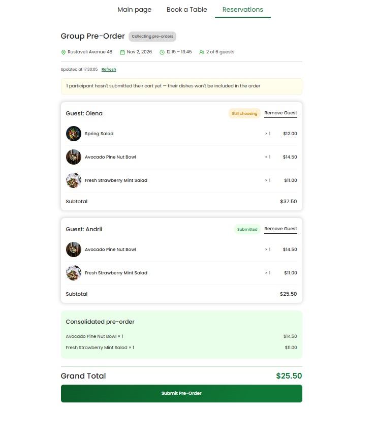
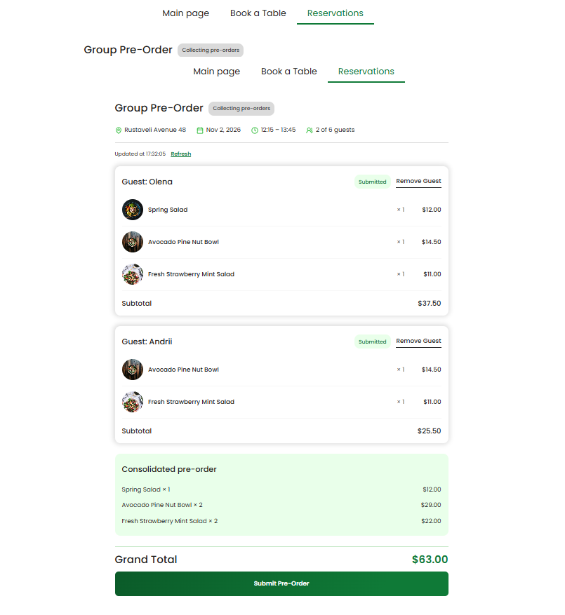
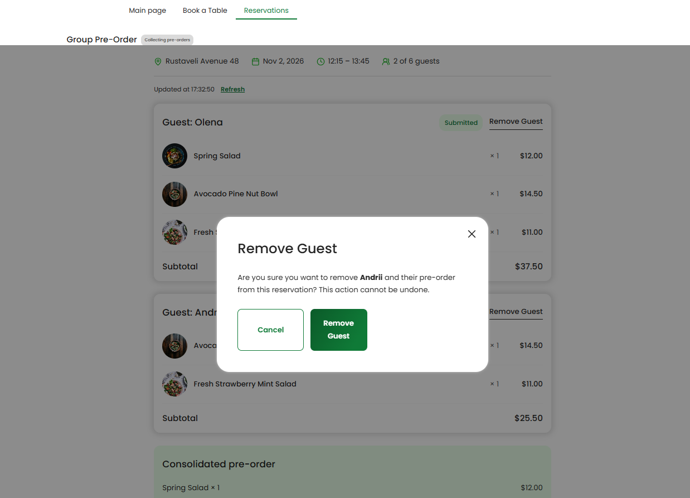
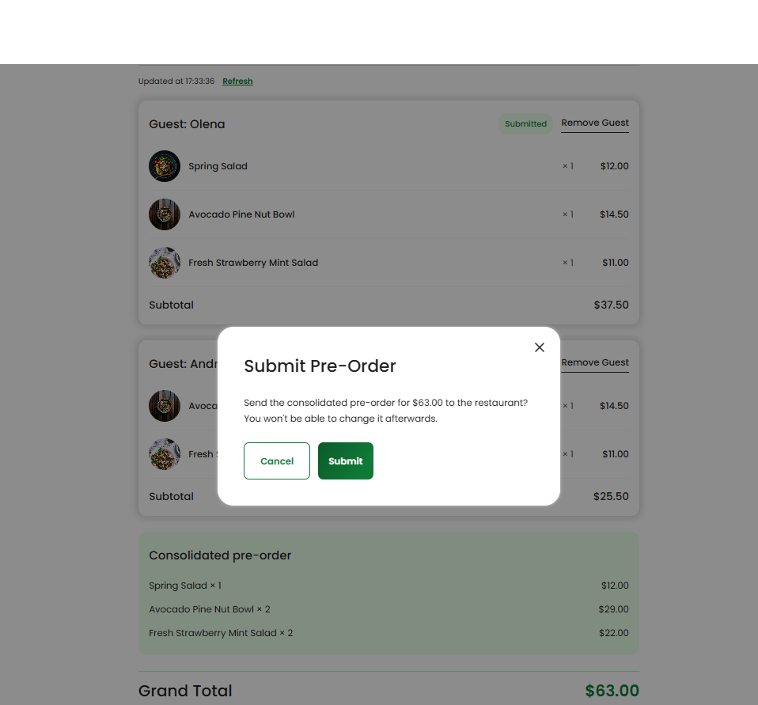
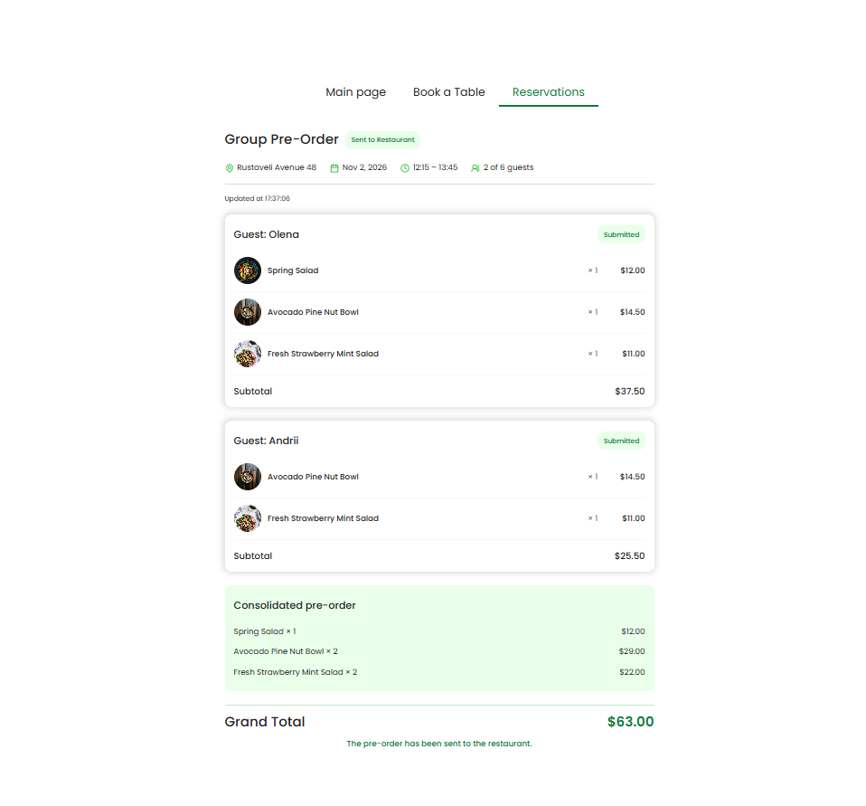

# Frontend #6 — Owner Review групового pre-order

Виконано всі рівні: **1, 2, 3 і бонус Remove Guest**.

## Що зроблено

- **Рівень 1** — сторінка `/reservations/:reservationId/group-order` за макетом: шапка (адреса, дата, час, «N of M guests»), картки учасників (`<article>`, статус кошика текстом), Grand Total, адаптивність до 375 px, кольори з `abstracts/colors`.
- **Рівень 2** — `GroupOrdersService` (invite → sessions, owner session id, status, submit); стан на `signal()`, похідні на `computed()`; «My Pre-Order»; консолідоване замовлення через `consolidatePreOrder()` — Grand Total рахує лише підтверджені кошики; жовта плашка; стани loading / error з «Try again» / empty / 404; Submit через `<app-modal>` із захистом від подвійного кліку; read-only після відправки.
- **Рівень 3** — справжній API (власний задеплоєний бекенд), фонова синхронізація кожні 15 с через `interval` + `exhaustMap` (без дублювання таймера, зупинка після Submit і при виході зі сторінки), тихі запити з `SKIP_ERROR_TOAST`, «Updated at …», «Refresh», «Couldn't refresh…».
- **Бонус** — Remove Guest: `canRemove` / `removeClick` у картці, діалог підтвердження, оновлення списку з відповіді сервера.
- Кнопка **Group Pre-Order** на картці бронювання (як у макеті) для бронювань на 2+ гостей.

## Знайдено під час інтеграції з реальним API

1. `token.interceptor.ts` не додавав токен Cognito до жодної адреси з `/guest/`, тому Owner-ендпоінти `GET/DELETE /guest/groups/{id}/sessions…` повертали **401**. Виправлено: для `/guest/groups/` додається токен Owner; для гостьових запитів тепер також враховується `SKIP_ERROR_TOAST`.
2. Бекенд ніде не створює owner-сесію (`CreateGroupOwnerSessionAsync` не викликається), тож `GET …/guest-session-id` повертає 404. Сторінка обробляє це м'яко: працює без підпису «My Pre-Order».
3. **Обмеження бекенду:** `GET /guest/invites/{token}` призначений для гостей і відмовляє, коли група повна («Guest limit exceeded») або вже не `Open`. Через це Owner не може відкрити екран повної або вже відправленої групи (після Submit — лише без перезавантаження). Правильне рішення — окремий Owner-ендпоінт, що повертає GroupReservationId за reservationId.

## Як перевірено

- `npm run test:hw` — **67 / 67**; обидва `tsc --noEmit` без помилок; `BACKEND_URL=https://example.com npm run build` — «Bundle check passed».
- Вручну на моках (`demo-reservation?demo`) і на **реальному API**: реєстрація → бронювання на 6 гостей → власний pre-order → 2 гості через invite-посилання в інкогніто → синхронізація статусу гостя без перезавантаження → Remove Guest (діалог) → Submit → «Sent to Restaurant».

## Використання AI

Так, Claude як ментор: пояснення Angular-підходів, рев'ю, пошук причин помилок інтеграції (401, обмеження invite-ендпоінта). Код перевірено тестами домашки та вручну на реальному бекенді.

## Скріншоти

|                                                                       |                                                                |
| --------------------------------------------------------------------- | -------------------------------------------------------------- |
|              |  |
|              |            |
|  |                                                                |
